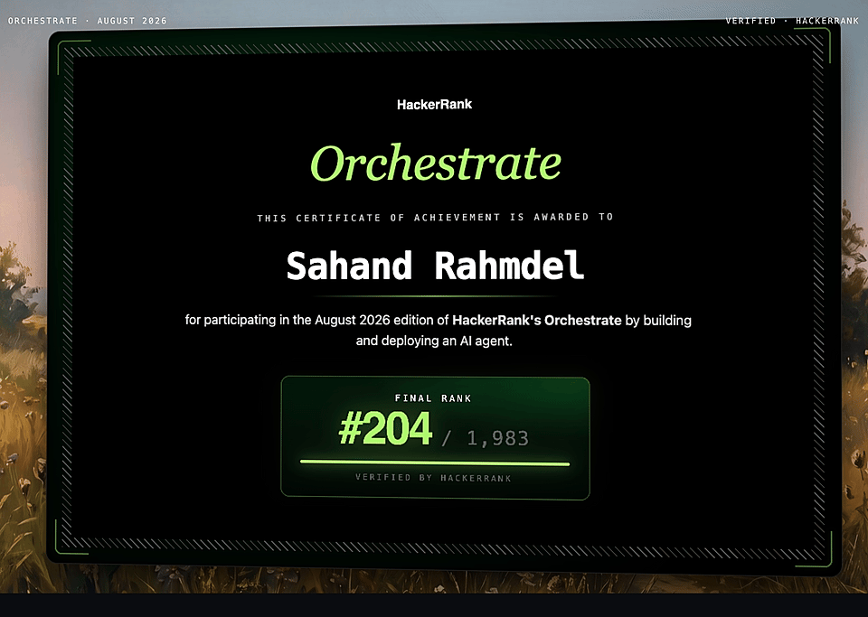

# WhatsApp Message Notifier - AI Routing System

An intelligent, multi-modal notification routing system built for the HackerRank Orchestrate hackathon.

## 🥉 Hackathon Award
> **Bronze Medal Winner** — Ranked in the **Top 10%** of participants (awarded to the top 15%).



This system evaluates incoming WhatsApp messages—including text, images, and voice notes—against a user's rich behavioral history, group context, business relationship, and safety guidelines. It ultimately decides whether a message requires an immediate notification (`notify`), should be batched for later (`digest`), or should be silently ignored (`mute`).

## Performance Highlights
- **Action Accuracy**: `96.67%`
- **Message Type Accuracy**: `83.33%`
- **Evidence Jaccard Similarity**: `37.78%` (with chronological deduplication and hallucination filtering)

## System Architecture Overview

Our solution utilizes a **Neuro-Symbolic** approach that splits the problem into two distinct phases:
1. **LOOK Phase**: A powerful Vision-Language Model (VLM) powered by Claude 3.5 Sonnet extracts semantic observations and categorizations from raw unstructured multi-modal inputs (text, OCR from images, transcripts from voice notes).
2. **DECIDE Phase**: A deterministic Python rule engine takes the structured JSON from the VLM and evaluates it against exact user preferences, database tables, business histories, and safety gates. 

For a deep dive into the architecture, thought process, and rules logic, please read the [Detailed Technical Guide](./code/README.md).

## Project Structure

```text
.
├── dataset/                     # Local data files and assets
├── code/                        # Core application source code
│   ├── core/                    # Core modules (Data Loader, Providers, Pipeline, Rules)
│   ├── evaluation/              # Scripts used for offline metric scoring
│   ├── main.py                  # The production entry point
│   └── README.md                # In-depth architectural guide
├── README.md                    # You are here
└── log.txt                      # The raw chat transcript log of the build process
```

## Setup & Installation

### Prerequisites
- Conda (Miniconda/Anaconda)
- Python 3.10+
- Anthropic API Key (`ANTHROPIC_API_KEY`)

### Environment Setup
1. Clone this repository to your local machine.
2. Create and activate a new conda environment:
   ```bash
   conda create -n hackathon python=3.10 -y
   conda activate hackathon
   ```
3. Install the required dependencies:
   ```bash
   pip install -r requirements.txt 
   # Alternatively: pip install anthropic python-dotenv pydantic openai-whisper pillow
   ```
4. Configure your `.env` file at the root of the project:
   ```text
   ANTHROPIC_API_KEY=your_api_key_here
   ```

## Running the Application

### 1. Generating Output
To run the production pipeline on the 110 unlabelled messages in `dataset/messages.csv`:
```bash
python code/main.py --no-resume
```
This script features safe resumability! If the API rate-limits you, you can run `python code/main.py` without the `--no-resume` flag, and it will pick up right where it left off, appending perfectly to `dataset/output.csv`.

### 2. Running Evaluation
To benchmark the system against the 30 ground-truth examples in `dataset/sample_messages.csv`:
```bash
python code/evaluation/main.py --no-resume
```
This will print the metrics matrix (Action Accuracy, Message Type, Jaccard Similarity) to your terminal.

## Authors
Sole Contributor: Sahand
AI Pair Programmer: Antigravity

---
*Built with speed, precision, and robust error handling during the HackerRank 24-Hour Orchestrate Challenge.*
